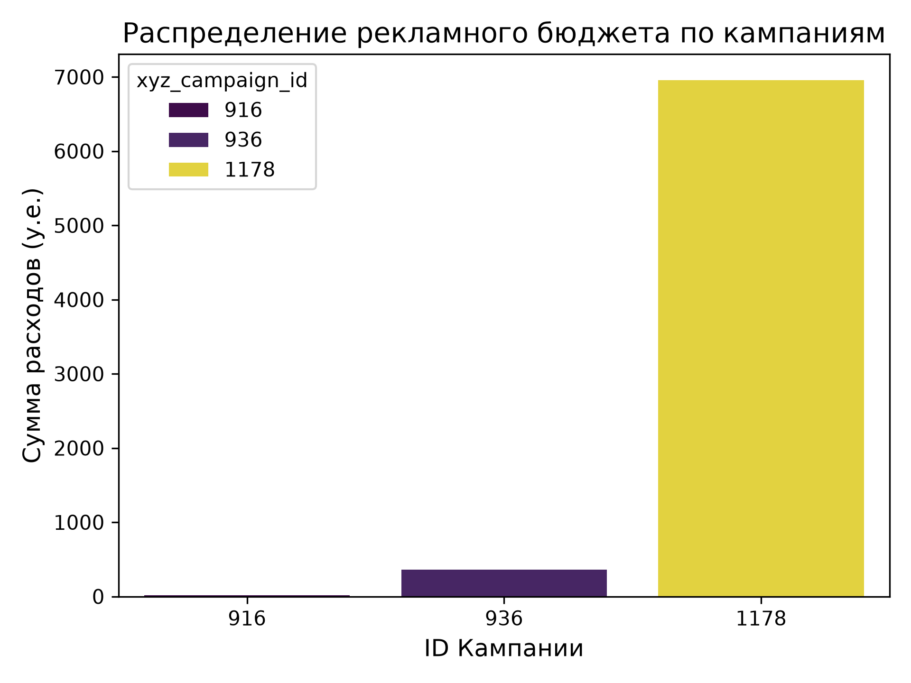
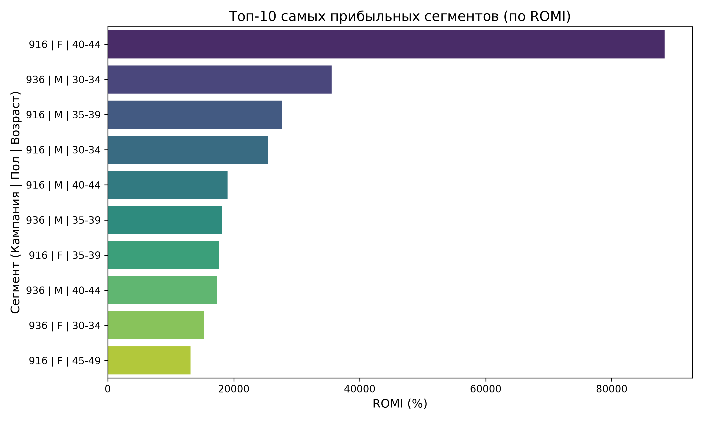
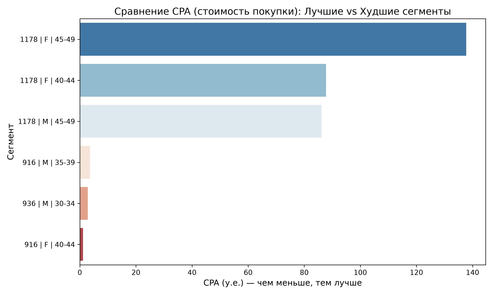

# Анализ маркетинговой воронки и юнит-экономики

## О проекте
Проект посвящен анализу эффективности рекламных кампаний на основе исторических данных (показы, клики, расходы, конверсии). 

**Цель:** Рассчитать ключевые маркетинговые метрики, оценить окупаемость (ROMI) и найти точки роста для оптимизации рекламного бюджета.

## Стек
* **SQL (PostgreSQL)** — развернута облачная БД (Clever Cloud), написаны запросы для агрегации данных и расчета метрик (оконные функции, агрегации).
* **Python (Pandas, SQLAlchemy)** — подключение к БД, извлечение и обработка данных.
* **Python (Matplotlib, Seaborn)** — визуализация данных.

## Этапы работы
1. Загрузка сырых данных в облачную PostgreSQL.
2. Расчет метрик воронки и юнит-экономики (CTR, CR, CPA, ROMI).
3. Сегментация аудитории по полу и возрасту.
4. Визуализация результатов и формирование бизнес-выводов.

## Ключевые результаты и инсайты

**1. Критический перекос рекламного бюджета**
Кампания `1178` забирает **~96% всего рекламного бюджета** (около 7 000 у.е.), при этом имеет самый высокий CPA (63.8 у.е.) и самую низкую конверсию (2.4%). В то же время кампания `916` практически не получает денег, но показывает лучший ROMI (15 930%).

**2. Сегменты с аномальной окупаемостью**
Самый прибыльный сегмент — **Женщины 40-44 лет из кампании 916** (CPA 1.13 у.е., ROMI 88 395%). 
Худшие результаты показывают **Женщины 45-49 лет из кампании 1178** (CPA 137.7 у.е., ROMI 625%). 

## Бизнес-выводы и рекомендации
По итогам анализа выявлен критический перекос в распределении рекламного бюджета:

1. **Сократить неэффективные расходы.** Рекомендуется **сократить бюджет кампании `1178` минимум на 50%**.
2. **Перераспределить средства в прибыльные сегменты.** Масштабировать бюджет на кампанию `916` (особенно на женщин 40-44 лет и мужчин 35-39 лет).
3. **Проверить таргетинг в кампании `1178`.** Аудитория 45-49 лет в этой кампании генерирует покупки по цене 86-137 у.е. Вероятно, трафик является нецелевым.
4. **Внедрить мониторинг.** Настроить регулярный контроль метрик ROMI и CPA для предотвращения подобных перекосов.

## Файлы в репозитории
* `analysis.ipynb` — Jupyter Notebook с кодом анализа.
* `budget_distribution.png` — график распределения бюджета.
* `top_segments.png` — график топ-10 сегментов по ROMI.
* `best_vs_worst_cpa.png` — сравнение лучших и худших сегментов по CPA.